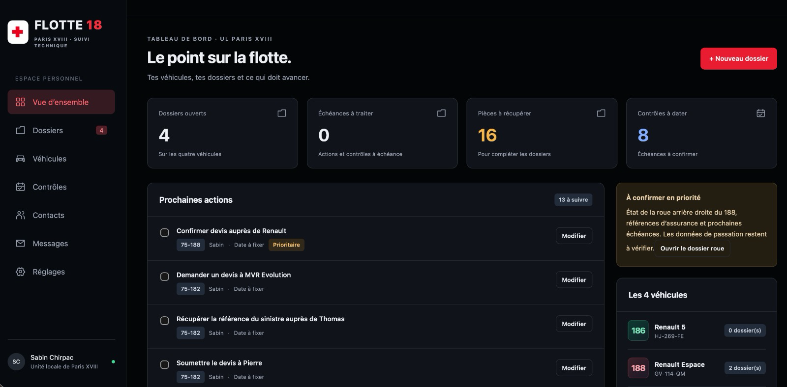

# Maquette — tableau de bord « Le point sur la flotte »

Structure à reproduire (contenu de démonstration, pas de valeurs figées). Le style suit les variables CSS de l'appli, clair et sombre.

## En-tête

- Surtitre « Tableau de bord · UL <nom> », titre « Le point sur la flotte. », sous-titre « Tes véhicules, tes dossiers et ce qui doit avancer. »
- Bouton principal « + Nouveau dossier » (CAP-8).

## Compteurs (4 cartes, chacune cliquable vers la liste filtrée)

| Carte | Valeur | Sous-titre | Cible |
|---|---|---|---|
| Dossiers ouverts | dossiers à l'état Ouvert de l'UL | « Sur les N véhicules » | Dossiers, filtre Ouvert |
| Échéances à traiter | tâches ouvertes à échéance ≤ 30 j + contrôles ≤ 30 j ou dépassés | « Actions et contrôles à échéance » | Contrôles + tâches à échéance |
| Pièces à récupérer | pièces non reçues des dossiers ouverts | « Pour compléter les dossiers » | Dossiers ayant des pièces manquantes |
| Contrôles à dater | échéances sans rendez-vous | « Échéances à confirmer » | Contrôles, filtre à dater |

## Prochaines actions

- Liste des tâches non terminées, triées : prioritaires d'abord, puis échéance croissante, « Date à fixer » en dernier. Badge « N à suivre ».
- Chaque ligne : case à cocher (→ Terminé), titre, pastille véhicule (ex. 75-188), assigné(s), échéance ou « Date à fixer », badge « Prioritaire », bouton « Modifier ».

## Colonne droite

- Encart « À confirmer en priorité » : texte du dossier/tâche mis en avant + bouton « Ouvrir le dossier ». Contenu : tous les dossiers et tâches épinglés (plusieurs possibles), échéance la plus proche d'abord, sans échéance en dernier ; un élément sort de l'encart quand on le désépingle, quand la tâche est terminée ou quand le dossier est clos. Sans épingle : la tâche Prioritaire non terminée à l'échéance la plus proche ; encart masqué si aucune.
- « Les N véhicules » : indicatif coloré, modèle, immatriculation, badge « N dossier(s) » ouverts ; clic → dossiers du véhicule.

## Navigation de la maquette

Vue d'ensemble · Dossiers (badge = dossiers ouverts) · Véhicules · Contrôles · Contacts · Messages · Réglages. Dans l'appli, le module est un onglet de `/vehicles` (réservé aux responsables) ; ces entrées y deviennent des sous-vues : Vue d'ensemble, Tâches (tableau à colonnes, CAP-5), Dossiers, Contrôles, Contacts. « Véhicules » renvoie aux fiches véhicule existantes, qui portent l'historique (CAP-13). « Messages » et « Réglages » sont hors périmètre.
