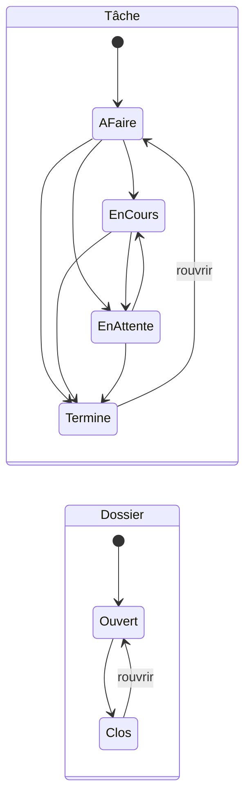

# Modèle du domaine — suivi technique de la flotte

Entités métier et règles de vie. Noms indicatifs ; le schéma SQL relève de l'architecture.

## Entités

| Entité | Portée | Champs métier clés | Règles |
|---|---|---|---|
| Contact | UL propriétaire | nom, catégorie (garage, carrosserie, assurance, dépannage, autre), téléphones (libellé + numéro), e-mail, adresse, notes, `partagé` | Modifiable par l'UL propriétaire seulement. Partagé → lisible et exportable par toutes les UL. |
| Dossier | UL | titre, véhicule, description, état (Ouvert / Clos), épinglé, créé par, dates | Rattaché à un véhicule de l'UL. Regroupe tâches, pièces à récupérer, pièces jointes. Jamais purgé : historique du véhicule. |
| Tâche | UL | titre, description, priorité (Normale / Prioritaire), échéance (facultative, « Date à fixer » si vide), état, assignés, dossier (facultatif), épinglée | Assignés ⊂ RESP_VEHICULE / ADMIN actifs de l'UL. Peut exister hors dossier. Visible et modifiable par tous les responsables de l'UL. Jamais purgée. |

Épingle « À confirmer en priorité » : autant de dossiers et de tâches épinglés que voulu par UL ; épingler ou désépingler est ouvert à tout responsable de l'UL.
| Rattachement | tâche | type (véhicule, contact, incident, maintenance), cible | Cible de la même UL ; un contact partagé par une autre UL est rattachable. Plusieurs par tâche. |
| Pièce à récupérer | dossier | libellé, reçue (oui/non), valeur reçue (texte), pièce jointe | Comptée tant que non reçue et dossier ouvert. |
| Pièce jointe | tâche ou dossier | fichier (PDF, image), nom, taille, déposé par, date | Stockée sur R2 par UL ; supprimée de R2 avec l'entrée. |
| Rendez-vous de contrôle | véhicule × type (CT, révision, désinfection) | date de rendez-vous, garage (contact facultatif) | L'échéance elle-même est calculée depuis le véhicule ; seul le rendez-vous est saisi ici. |

## États

Toute transition entre états de tâche est permise (tableau libre façon Trello) ; le diagramme montre l'usage courant. Libellés affichés : À faire, En cours, En attente, Terminé ; Ouvert, Clos.

## Échéances de contrôle

| Type | Source de l'échéance | « À dater » | « À traiter » |
|---|---|---|---|
| Contrôle technique | `getNextCtDate` (`src/lib/maintenanceUtils.ts`) | aucun rendez-vous saisi | échéance ≤ aujourd'hui + 30 j ou dépassée |
| Révision | `getNextRevision` (`src/lib/maintenanceUtils.ts`) | idem | idem |
| Désinfection (VPSP) | `Vehicle.nextDesinfMaxDate` | idem | idem |

Un rendez-vous passé sans nouvelle échéance calculée reste affiché jusqu'à la mise à jour des données véhicule.
